# Chocofi ZMK config

[ZMK](https://zmk.dev) firmware for my Chocofi: a 36-key split keyboard (3×5 + 3 thumb keys per half) with nice!nano v2 controllers and nice!view displays, used with macOS.

Legends use macOS symbols: ⌘ Command, ⌥ Option, ⌃ Control, ⇧ Shift. The highlighted thumb key on each layer is the one held to reach it.

## Layers

| Layer | How to reach it | What's on it |
|---|---|---|
| **Base** | — | QWERTY |
| **Nav** | hold the right middle thumb key | arrows on I J K L, ⇧ ⌃ ⌥ ⌘ on A S D F, Enter, Backspace, Caps Lock |
| **Num** | hold the left middle thumb key | numbers, symbols, macOS shortcuts |
| **Fn** | hold both middle thumb keys | F1–F10, volume, zoom, Bluetooth |

The right outer thumb key is a tap dance: tap for ⌥ (right Option), double-tap for ⌃. The left half's display shows the current layer name.

## Bluetooth

The Bluetooth keys on the Fn layer only fire after being **held for 3 seconds**. A short press, or pressing another key meanwhile, does nothing, so a stray tap can't drop a pairing.

- **Z X C V B**: switch to profile 0–4.
- **A**: forget the host paired on the current profile. Then remove "Chocofi" in macOS Bluetooth settings and pair again.

If pairing stays broken (it happened after a macOS upgrade), flash `settings_reset` to both halves, then the normal firmware to both.

## Build and flash

GitHub Actions builds the firmware on every push (targets are in `build.yaml`). Download the `firmware` artifact of the run. For each half: double-tap reset, wait for the `NICENANO` drive, and copy that half's `.uf2` (`corne_left …` or `corne_right …`) onto it. Flash both halves from the same build.

## Keymap picture

`keymap-drawer/corne.svg` is generated from `config/corne.keymap` by [keymap-drawer](https://github.com/caksoylar/keymap-drawer). After changing the keymap, run `scripts/draw-keymap.sh` (needs [uv](https://docs.astral.sh/uv/)); in Claude Code, a project hook in `.claude/settings.json` does it automatically.
